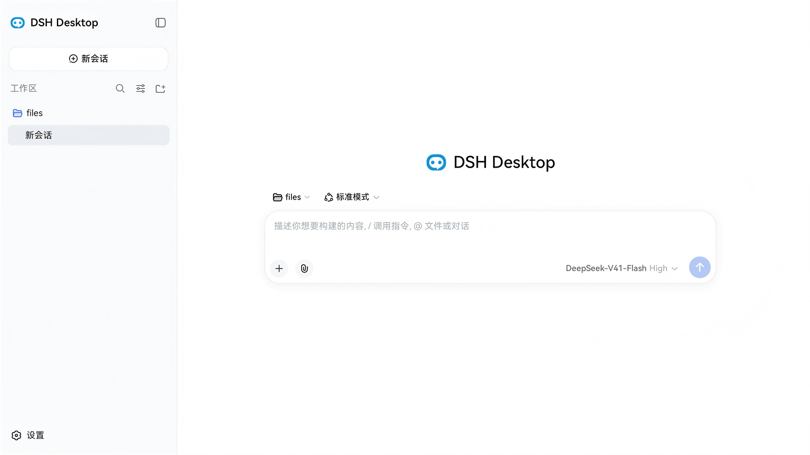
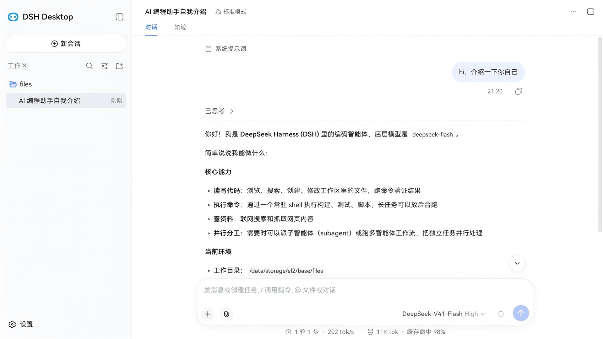
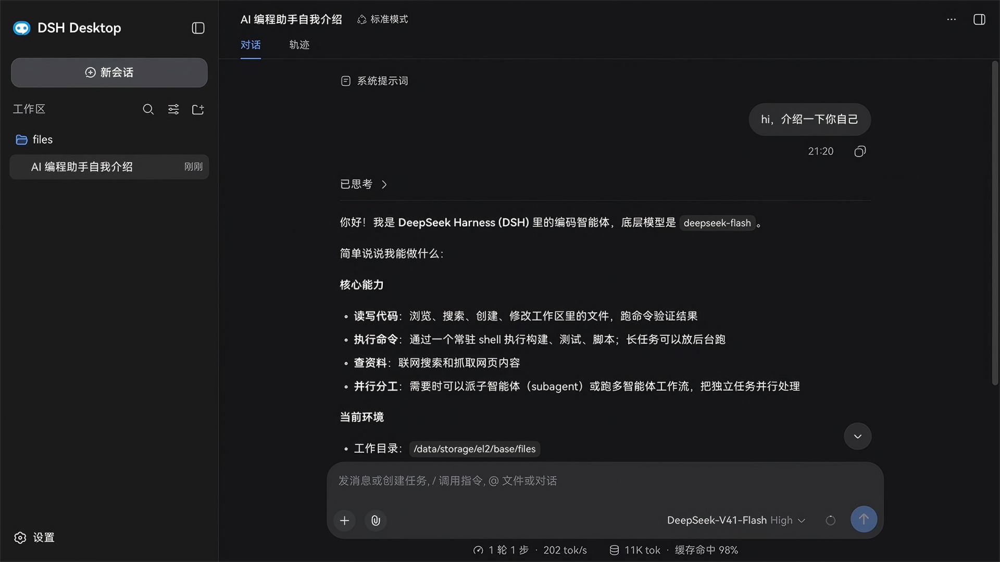
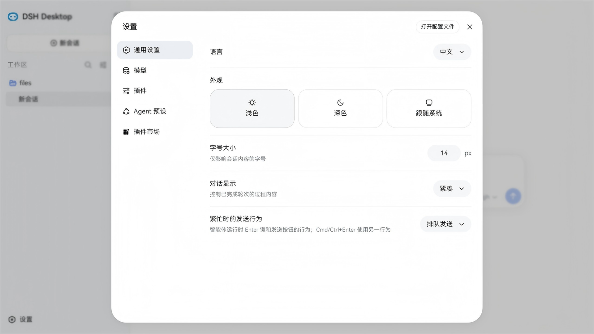
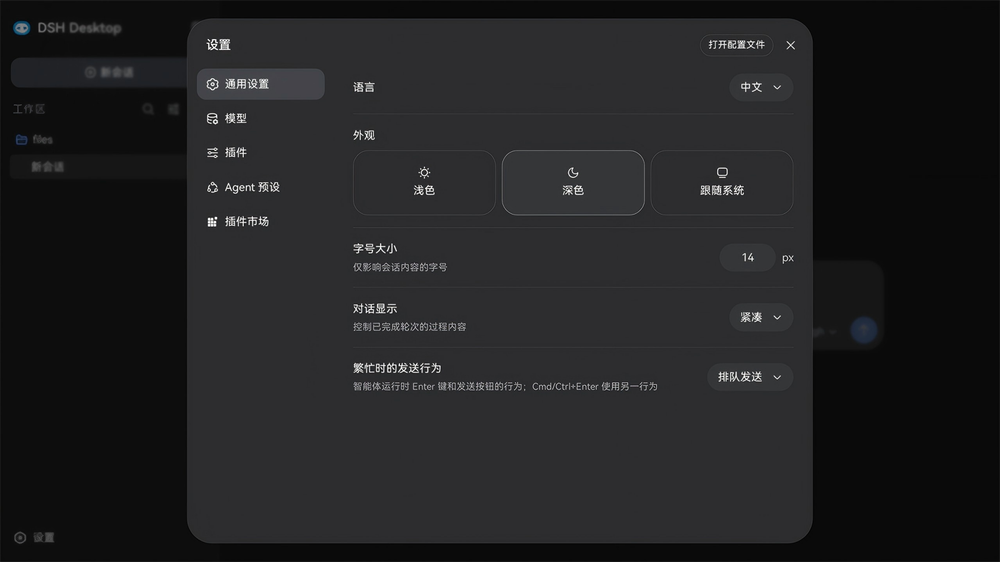

[中文](./README_zh.md) | English

# DSH Desktop · Electron on HarmonyOS Edition

> **Electron on HarmonyOS Edition** — the official DeepSeek Harness (DSH) Web UI, **unmodified**, running on HarmonyOS 2in1 / tablet through Electron 37: a real Electron app on HarmonyOS, not an ArkUI rewrite of the interface. The other HarmonyOS edition, [HarmonyOS Edition](https://github.com/fellow99/dsh-desktop-ark), drops Electron entirely — system ArkWeb plus an in-process Node runtime.

<p align="center">
  
</p>
<p align="center"><sub><b>Device capture, not a mockup</b> — HarmonyOS 6.1.0.135 (API 24), 2in1. The UI is the official dsh Web UI, loaded same-origin from the in-process dsh Host.</sub></p>

<p align="center">
  
  
  
  
  
</p>

**Status** `0.2.1` (`versionCode` 1009) — built and signed. Core flows (chat, agent loop, tool calls, session persistence, plugin market, window state) were verified on a HarmonyOS 6.1.0.135 (API 24) device for **0.2.0**; the **0.2.1** build has not been re-verified on device yet (build + signature verified only). Distribution reality up front: a **debug-signed HAP is bound to the signing account/device**, and a **release-signed package can only ship through AppGallery** — see [How to get it](#how-to-get-it).

## Why this port is different

There are other ways to get DSH onto HarmonyOS. The trade-off is the whole story of this repo:

| | This project (Electron route) | A native-host route (Node runtime + ArkUI host) |
|---|---|---|
| Interface | The **official Web UI, byte-for-byte** — nothing re-implemented | A native host around the same Web content; platform chrome is rewritten |
| Fidelity to desktop | Identical semantics: same renderer, same Node APIs, same data plane | Good, but the host layer is a re-implementation that must track upstream |
| Runtime permission | Requires the ACL restricted permission `ohos.permission.kernel.ALLOW_WRITABLE_CODE_MEMORY` (JIT) — **2in1 / tablet only** | No JIT, so no such permission |
| Device reach | HarmonyOS 2in1 / tablet | Can extend to phones |

Neither is "better"; they optimize different things. This repo exists to prove the Electron route end-to-end — including every sandbox conflict it hits. The other editions share the same shell architecture and data plane: [dsh-desktop](https://github.com/fellow99/dsh-desktop) for Windows / Linux / macOS, and [dsh-desktop-ark](https://github.com/fellow99/dsh-desktop-ark) for the **HarmonyOS Edition** (system ArkWeb + an in-process Node runtime, no Electron).

## What works today

| Capability | State |
|---|---|
| dsh Web UI in a window (100% reuse of the dsh frontend) | ✅ |
| Session persistence + full-text search (`better-sqlite3`, aarch64 ABI 138) | ✅ |
| Plugin marketplace (`dshmarket` built in) | ✅ |
| Window state persistence (maximized / bounds) + F11 fullscreen | ✅ |
| Command execution — non-PTY resident `/system/bin/sh` driven by a sentinel-line protocol, with a tool-layer path fence | ✅ ⚠️ the fence is **best-effort and bypassable, not a sandbox** |
| Image attachments — `sharp` replaced by a pure-JS container parser; conversions it cannot do are routed through the platform image framework by an ArkTS bridge (decode / EXIF / scale / re-encode) | ⚠️ clean 8-bit sRGB files pass through byte-identically; with no bridge reachable every conversion is refused with an explicit error; no thumbnails |
| Bundling our own Node / pnpm / Python runtime | ⛔ **not possible** — shipping an ELF requires a binary certificate (AGC `certType: 4`), which Huawei does not grant to individual developers. The host installing `pnpm` from the system terminal is an **optional dependency, never a product capability** |
| Process sandbox (`koffi` / landlock) | ❌ out of scope |

### Limits, in detail

- **Command execution.** Upstream's `tool-bash` row stays disabled: `node-pty` has no aarch64 artifact, and PTY is denied by SELinux. The replacement spawns a resident `/system/bin/sh` and reads replies through a sentinel line; the path fence lives in the tool layer and is **bypassable by design**.
- **Bundled runtime.** The app already sees `/data/service/hnp/bin` on `PATH` and a structurally valid `node` lives there — only `pnpm` is missing. Once the user installs `pnpm` **from the system terminal** (the symlink ban is app-domain-only, so it must not be installed from inside the app), the marketplace's `probePnpm()` succeeds and plugin install/uninstall works. Nothing else depends on a bundled runtime: command execution spawns the system's own `sh`/`toybox`, and the file / search / skill / subagent / workflow / image features are pure JS. Analysis: [`docs/鸿蒙环境能力清单-v0.1.5.md`](docs/鸿蒙环境能力清单-v0.1.5.md) §C.8.
- **Images.** The stub parses PNG/JPEG/GIF/WebP container headers; anything it cannot convert is handed to the ArkTS bridge (decode, EXIF orientation, scale, re-encode to JPEG/WebP/PNG). Clean 8-bit sRGB input inside the limits passes through byte-identically at zero conversion cost. With no bridge reachable (plain Node), every conversion is refused with an explicit, attributed error. No thumbnails.

Deferred by decision, not by oversight: the frameless window (moving window controls into the renderer costs more than it buys) and launch-at-login (`autoStartupManager` exposes read-only queries only). The system tray ships today — status-bar icon plus right-click menu.

## Screens

| | Light | Dark |
|---|---|---|
| **Agent conversation** — tool calls, session trace, model and cache telemetry |  |  |
| **Settings** — models, plugins, agent presets, plugin market, appearance |  |  |

## How to get it

Three routes, in order of convenience:

1. **AppGallery (planned).** Release-signed App Packs can only be installed from AppGallery. Two prerequisites gate the listing: the ACL restricted permission (≈3 business days review, mainland-China developer accounts only) and the AI compliance track (algorithm filing / model registration / security assessment). See [maintainer guide](docs/构建签名与上架.md).
2. **Build it yourself** — the supported route today. Four stages, then a local HAP: `collect-runtime → build-dsh → collect-dsh → tar`, then `scripts/build-debug.ps1`. See the [maintainer guide](docs/构建签名与上架.md). Requirements: DevEco Studio 4.0+, HarmonyOS SDK API 17+ (targetSdk 6.1.1(24)), Node 18+, pnpm@11, HDC.
3. **Re-sign a debug build with your own account.** A debug profile is device-bound, so someone else's debug HAP will not install on your machine; regenerate the profile in DevEco (`File → Project Structure → Signing Configs`) and rebuild. See the [maintainer guide](docs/构建签名与上架.md).

> ⚠️ `hdc app install` on a **release**-signed package fails with `code:9568322 ... not trusted app source`. For on-device regression use `-BuildMode release -SignMode debug`.

## Compatibility

| Shell | dsh (upstream tag) | Runtime | Device / API | Verified |
|---|---|---|---|---|
| `0.2.1` · `versionCode` 1009 | `dsh-v0.2.1-rc.2` | Electron 37 / Node 22.17.0 (`harmonypc-electron`) | HarmonyOS 6.1.0.135 · API 24 · 2in1 / tablet | built & signed; on-device re-verification pending (0.2.0 was verified) |

`versionCode` must be a number and must **strictly increase** on every AppGallery submission. Upstream dsh is a developer preview: each shell pins one tag, and `patches/<dsh-tag>/` moves with it.

## Architecture

One process, one origin on the device: the Electron main process **hosts the dsh Host** (webserver + API + WebSocket) and the window loads the standard dsh Web UI from it — no CORS, no auth, no custom protocol, no IPC carrier.

```
EntryAbility (ArkTS) → Electron-on-HarmonyOS → main process (Node 22.17)
  └─ dsh Host: webserver on 0.0.0.0:<port> · apiProxy · connection
  └─ window: the unmodified dsh Web UI, loaded same-origin from that port
```

Three HarmonyOS adaptations make it work: **loopback isolation** (bind a wildcard address, then rewrite `Host`/`Origin` back to loopback inside the session), **no symlinks or hardlinks** (copy for profile publishing, same-directory `rename` for atomic writes), and **`HOME` redirection** into the sandbox. Because the listener is wildcard, treat this as a single-user local app and keep it off untrusted networks. The patch list, threat notes and the full rationale live in the [maintainer guide](docs/构建签名与上架.md).

## Tech stack

- **Electron-on-HarmonyOS** runtime ([`harmonypc-electron`](https://atomgit.com/jianguoxu/harmonypc-electron)) — Electron 37 / Node 22.17.0
- **ArkTS / ArkUI** (Stage model) with the `web_engine` bridge HAR
- Upstream [`deepseek-harness`](https://github.com/deepseek-ai/deepseek-harness) pinned at `dsh-v0.2.1-rc.2`; this shell's patches live in `patches/dsh-v0.2.1-rc.2/`

## Build, sign & install

Requirements: DevEco Studio 4.0+ or the Command Line Tools, HarmonyOS SDK API 17+ (target 6.1.1 / API 24), Node 18+, pnpm, `hdc`.

```
node scripts/collect-runtime.mjs    # ① copy the runtime, then re-apply this app's customizations
node scripts/build-dsh.mjs          # ② apply the 13 patches, build dsh + dsh-market
node scripts/collect-dsh.mjs        # ③ materialize dsh-dist
powershell scripts\build-debug.ps1  # ④ build + sign the HAP
hdc app install -r entry/build/default/outputs/default/entry-default-signed.hap
```

Signing material never enters the repository (`signing.<mode>.local.json`, gitignored). Release signing, the ACL restricted permission, AppGallery submission, on-device debugging and the four-stage pipeline are documented in the [maintainer guide](docs/构建签名与上架.md).

## Directory structure

This project and the 3 consumed projects plus 1 architecture-reference project live in **sibling directories** (not submodules):

```
(sibling directories)
├── dsh-desktop-hos/      # This project (HarmonyOS HAP, HarmonyOS desktop port)
│   ├── AppScope/                  # App scope (icon/name/signing)
│   ├── electron/                  # Entry module (copied from harmonypc-electron, contains SOs)
│   ├── web_engine/                # Bridge HAR (ArkTS bridge layer + resfile carries dsh artifacts)
│   ├── src-main/                  # Main process main.js (extract + runProfile + loadURL + HarmonyOS adaptations)
│   ├── scripts/                   # Four-stage build: collect-runtime → build-dsh → collect-dsh, plus build-debug / build-release
│   ├── runtime-overlays/          # App customizations re-applied after every runtime copy (prune + overlay)
│   ├── profiles/desktop/          # Custom desktop profile (cordis.patch.yml + package.json)
│   ├── patches/                   # dsh upstream patches (14)
│   ├── docs/                      # Engineering plan and final implementation record
│   ├── plugins/                   # This project's own plugins (harmony-plugin-XXX; baked into the HAP, all loaded by default)
│   ├── skills/                    # This project's own tool skills (kebab-case, no prefix; shipped in the HAP as the bundled skill root)
│   └── specs/                     # Spec documents (as-built; see specs/README.md for index)
│
├── harmonypc-electron/            # Electron-on-HarmonyOS runtime (Electron 37 / Node 22.17.0)
│   └── ohos_hap/                  # electron + web_engine modules + SO source (collect-runtime copy source)
│
├── deepseek-harness/              # The wrapped host (dsh, source reference, not a submodule)
│   ├── apps/                      # cli (dsh bin / profile-boot), web (frontend, build:web produces dist)
│   ├── packages/                  # host / client / core / session workspace packages
│   ├── vendor/                    # vendored cordis framework packages (cordis / loader / hmr / …)
│   └── native/                    # landlock-run native module (Linux sandbox, cut in MVP)
│
└── dsh-market/                    # Plugin marketplace (source reference, npm pkg "dshmarket")
    ├── src/                       # host half (mounts /dsh-market/* routes)
    ├── client/                    # browser half (settings-page UI)
    ├── lib/                       # compiled host output (materialized into dsh-dist/node_modules/dshmarket)
    └── cordis.patch.yml           # loader insert declaration ({ id: dsh-market, name: dshmarket })
```

> `../dsh-desktop` is an **architecture-design reference** (reuses its architecture decisions + patches + main-process orchestration logic) and does not participate in this project's build/packaging.

## Related docs

- [docs/鸿蒙环境能力清单-0.2.1.md](docs/鸿蒙环境能力清单-0.2.1.md) — capability inventory for 0.2.1: what works on this edition, what does not, and how the ArkWeb edition compares
- [docs/构建签名与上架.md](docs/构建签名与上架.md) — maintainer guide: architecture, tech stack, build stages, signing, on-device debugging, AppGallery submission
- [docs/工程规划.md](docs/工程规划.md) — full engineering plan + final implementation record (Electron 37 landing, key adaptation changes, MVP trade-offs, cross-compilation optimization path)
- [specs/README.md](specs/README.md) — spec document index (project-level + 9 module spec/plan, as-built)

## References

- [deepseek-harness](https://github.com/deepseek-ai/deepseek-harness) (sibling directory `../deepseek-harness`) — the wrapped host; its `docs/` directory contains full architecture docs
- [dsh-market](https://github.com/dsh-market/dsh-market) (sibling directory `../dsh-market`) — the built-in visual plugin marketplace (npm package `dshmarket`), materialized via `collect-dsh.mjs`
- [harmonypc-electron](https://atomgit.com/jianguoxu/harmonypc-electron) (sibling directory `../harmonypc-electron`) — the Electron-on-HarmonyOS runtime
- [dsh-desktop](https://github.com/fellow99/dsh-desktop) (sibling directory `../dsh-desktop`) — architecture-design reference (Electron desktop shell)
- [dsh-desktop-ark](https://github.com/fellow99/dsh-desktop-ark) (sibling directory `../dsh-desktop-ark`) — the **HarmonyOS Edition**: same dsh Host on `ohos-node-bridge` (in-process Node v24.2.0), rendered by the system ArkWeb, no Electron
- [DSH Desktop website](https://fellow99.github.io/dsh-desktop-website/) — all three editions, real device screenshots, and the architecture story in one page

## License

[MIT](LICENSE) © 2026 fellow99
